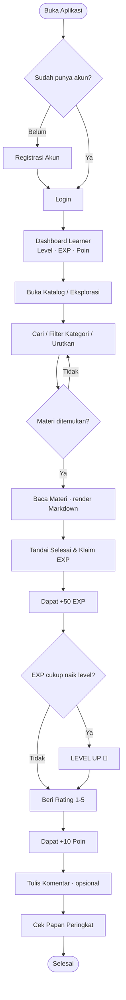
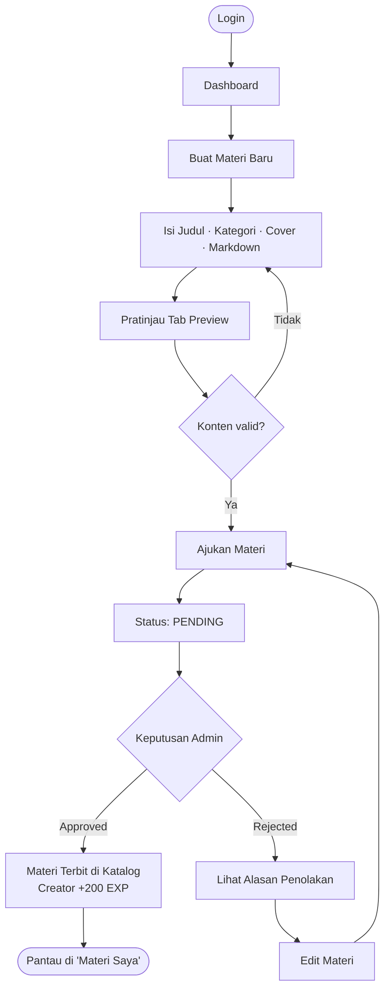
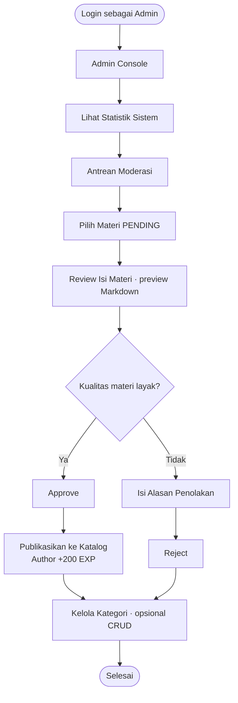
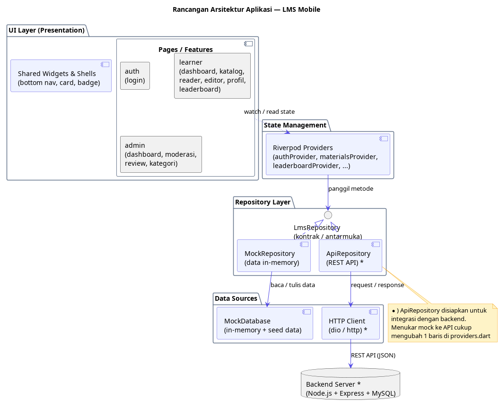
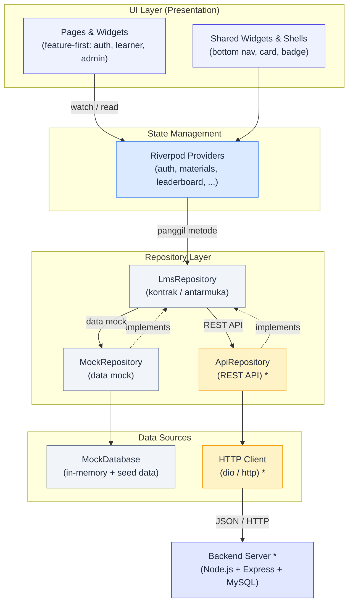

# Laporan Perencanaan Aplikasi

## LMS Mobile — Gamified Learning Platform

---

## 2. Pendahuluan

### 2.1 Latar Belakang Pengembangan Aplikasi

Pembelajaran digital saat ini telah menjadi kebutuhan utama, namun sebagian besar platform pembelajaran masih bersifat satu arah: pengguna hanya menjadi konsumen materi tanpa ruang untuk berkontribusi. Di sisi lain, rendahnya motivasi pengguna untuk menyelesaikan materi menjadi permasalahan yang umum dijumpai pada platform e-learning.

Berangkat dari kondisi tersebut, dikembangkan sebuah aplikasi **Learning Management System (LMS)** berbasis mobile yang menerapkan konsep **gamifikasi** (EXP, Level, Poin, dan Papan Peringkat) dengan model **pembelajaran dua arah**. Pengguna tidak hanya membaca materi, tetapi juga dapat berperan sebagai kreator yang menyusun materi pembelajaran sendiri menggunakan editor berbasis Markdown. Untuk menjaga kualitas konten, setiap materi yang diajukan melewati proses kurasi (moderasi) oleh Admin sebelum dipublikasikan.

Pengembangan versi mobile ini merupakan tindak lanjut dari sistem yang sebelumnya dibangun pada platform web, dengan tujuan menghadirkan pengalaman belajar yang lebih praktis dan dapat diakses kapan saja melalui perangkat Android dan iOS.

### 2.2 Identifikasi Permasalahan

Berdasarkan latar belakang di atas, dapat diidentifikasi beberapa permasalahan:

1. Platform pembelajaran umumnya bersifat satu arah sehingga pengguna tidak dapat berkontribusi menyusun materi.
2. Rendahnya keterlibatan (engagement) dan motivasi pengguna dalam menyelesaikan materi pembelajaran.
3. Kualitas konten yang bervariasi karena tidak adanya mekanisme kurasi sebelum materi dipublikasikan.
4. Keterbatasan akses ketika pembelajaran hanya tersedia pada perangkat desktop/komputer.
5. Belum tersedianya sistem yang memberi umpan balik (reward) atas aktivitas belajar pengguna.

### 2.3 Rumusan Masalah

1. Bagaimana merancang aplikasi LMS berbasis mobile yang mendukung pembelajaran dua arah (membaca dan membuat materi)?
2. Bagaimana menerapkan mekanisme gamifikasi (EXP, Level, Poin, dan Papan Peringkat) untuk meningkatkan motivasi pengguna?
3. Bagaimana merancang alur moderasi konten agar kualitas materi terjaga sebelum dipublikasikan?
4. Bagaimana merancang aplikasi agar dapat dijalankan pada perangkat Android dan iOS dengan pengalaman yang konsisten?

### 2.4 Tujuan dan Manfaat Pengembangan Aplikasi

**Tujuan:**

1. Menghasilkan aplikasi LMS mobile yang mendukung pembelajaran dua arah.
2. Menerapkan sistem gamifikasi sebagai sarana peningkatan motivasi belajar.
3. Menyediakan mekanisme moderasi konten (Approve/Reject) oleh Admin.
4. Menyajikan materi dalam format Markdown yang mendukung penyorotan kode (syntax highlighting).

**Manfaat:**

- **Bagi Pengguna (Learner):** memperoleh pengalaman belajar yang lebih menarik, terukur melalui Level dan EXP, serta akses materi kapan pun melalui perangkat mobile.
- **Bagi Kreator:** mendapat wadah untuk berbagi pengetahuan dan memperoleh penghargaan berupa EXP serta Poin.
- **Bagi Admin:** tersedianya alat moderasi dan pengelolaan kategori yang terstruktur.
- **Bagi Pengembang:** menjadi sarana penerapan ilmu Mobile Programming, khususnya penggunaan framework Flutter.

---

## 3. Deskripsi Aplikasi

### 3.1 Nama dan Konsep Aplikasi

- **Nama Aplikasi:** LMS Mobile
- **Konsep:** Platform Pembelajaran Dua Arah berbasis **Gamifikasi**

Konsep utama aplikasi adalah memadukan kegiatan belajar dengan sistem penghargaan (reward) layaknya permainan. Setiap aktivitas bermakna—menyelesaikan bacaan, membuat materi, memberi rating—memberikan imbalan berupa **EXP** dan **Poin** yang meningkatkan **Level** pengguna serta menentukan posisinya pada **Papan Peringkat**.

### 3.2 Deskripsi Umum Aplikasi

LMS Mobile adalah aplikasi berbasis Flutter yang menyediakan tiga peran pengguna: **Guest**, **Learner/Creator**, dan **Admin**.

- **Materi** disusun menggunakan **Markdown** sehingga ringan dan mendukung penyorotan kode program.
- Setiap materi baru berstatus **Pending**, dan hanya materi berstatus **Approved** yang terbit di katalog publik.
- Pengguna mendapatkan **+50 EXP** saat menyelesaikan bacaan, **+200 EXP** saat materinya disetujui Admin, **+10 Poin** saat memberi rating, serta bonus untuk kreator yang menerima rating tinggi.

### 3.3 Target Pengguna (User)

| Peran | Deskripsi |
| --- | --- |
| **Guest** | Pengguna tanpa akun; hanya dapat meramban katalog materi publik secara terbatas. |
| **Learner / Creator** | Pengguna terautentikasi; dapat membaca materi, membuat materi, memberi rating, berkomentar, serta mengumpulkan EXP dan Poin. |
| **Admin** | Pengguna dengan hak akses khusus; memoderasi materi, mengelola kategori, dan memantau statistik sistem. |

### 3.4 Solusi yang Ditawarkan oleh Aplikasi

1. **Pembelajaran dua arah** — pengguna dapat membaca sekaligus menyusun materi.
2. **Gamifikasi** — EXP, Level, Poin, dan Papan Peringkat meningkatkan motivasi.
3. **Kurasi konten** — alur moderasi Admin menjaga kualitas materi.
4. **Format Markdown** — penyajian materi ringan dan mendukung blok kode.
5. **Akses mobile** — dapat digunakan di Android dan iOS melalui satu basis kode.

---

## 4. Analisis Kebutuhan Sistem

### 4.1 Kebutuhan Fungsional

| Kode | Kebutuhan Fungsional |
| --- | --- |
| F-01 | Sistem dapat melakukan registrasi dan login pengguna. |
| F-02 | Sistem dapat menampilkan katalog materi yang telah disetujui. |
| F-03 | Sistem dapat melakukan pencarian, filter kategori, dan pengurutan materi. |
| F-04 | Sistem dapat menampilkan detail materi (Markdown) beserta informasinya. |
| F-05 | Pengguna dapat menandai materi selesai dan menerima EXP. |
| F-06 | Pengguna dapat memberikan rating bintang 1–5 dan menerima Poin. |
| F-07 | Pengguna dapat menambahkan komentar pada materi. |
| F-08 | Pengguna dapat membuat dan mengubah materi (editor Markdown). |
| F-09 | Pengguna dapat melihat status materi (Pending/Approved/Rejected) beserta alasan penolakan. |
| F-10 | Admin dapat melihat antrean moderasi dan menyetujui/menolak materi. |
| F-11 | Admin dapat mengelola kategori (Create, Read, Update, Delete). |
| F-12 | Admin dapat melihat statistik sistem. |
| F-13 | Sistem dapat menampilkan Papan Peringkat berdasarkan EXP. |
| F-14 | Sistem menghitung Level secara otomatis berdasarkan total EXP. |

### 4.2 Kebutuhan Nonfungsional

| Aspek | Kebutuhan |
| --- | --- |
| **Keamanan** | Kontrol akses berbasis peran (RBAC) yang ketat antara Learner dan Admin; proteksi terhadap celah XSS pada konten Markdown. |
| **Performa** | Waktu muat materi dan Papan Peringkat responsif (target < 2 detik); render Markdown tanpa lag. |
| **Usability** | Antarmuka konsisten dan mudah digunakan; mendukung mode terang dan gelap. |
| **Portabilitas** | Berjalan pada Android dan iOS dari satu basis kode. |
| **Skalabilitas** | Struktur data siap menampung penambahan materi, komentar, dan skor peringkat. |

### 4.3 Identifikasi Pengguna dan Hak Akses

| Fitur | Guest | Learner/Creator | Admin |
| --- | :-: | :-: | :-: |
| Meramban katalog publik | ✔ | ✔ | ✔ |
| Membaca detail materi | – | ✔ | ✔ |
| Menandai selesai & klaim EXP | – | ✔ | – |
| Memberi rating & komentar | – | ✔ | – |
| Membuat/mengubah materi | – | ✔ | – |
| Melihat Papan Peringkat | ✔ | ✔ | ✔ |
| Moderasi materi (Approve/Reject) | – | – | ✔ |
| Mengelola kategori | – | – | ✔ |
| Melihat statistik sistem | – | – | ✔ |

### 4.4 Kebutuhan Perangkat Keras dan Perangkat Lunak

**Perangkat Keras (Pengembangan):**
- Komputer/Laptop dengan RAM minimal 8 GB (disarankan 16 GB)
- Perangkat Android/iOS atau emulator/simulator
- Koneksi internet

**Perangkat Lunak (Pengembangan):**
- Sistem Operasi: Windows / Linux / macOS
- **Flutter SDK** (versi 3.50) dan **Dart** (versi 3.14)
- **Android Studio** (Android SDK) dan/atau **Xcode** (iOS)
- **Visual Studio Code** atau Android Studio sebagai editor
- Emulator Android / Simulator iOS
- Git untuk manajemen versi

**Perangkat Lunak Pendukung (Sisi Server — opsional untuk integrasi):**
- Node.js + Express.js (backend REST API)
- MySQL sebagai basis data
- Postman untuk pengujian API

---

## 5. Perancangan Fitur Aplikasi

### 5.1 Daftar Fitur Utama

| No | Fitur | Modul |
| --- | --- | --- |
| 1 | Autentikasi (Login) | Auth |
| 2 | Dashboard Gamifikasi | Learner |
| 3 | Katalog & Pencarian Materi | Learner |
| 4 | Reader Materi (Markdown) | Learner |
| 5 | Klaim EXP (Selesai Baca) | Gamifikasi |
| 6 | Rating & Komentar | Interaksi |
| 7 | Editor Materi (Markdown) | Creator |
| 8 | Kelola Materi Saya | Creator |
| 9 | Papan Peringkat | Gamifikasi |
| 10 | Profil Pengguna | Learner |
| 11 | Antrean & Review Moderasi | Admin |
| 12 | Kelola Kategori | Admin |
| 13 | Statistik Dashboard Admin | Admin |

### 5.2 Penjelasan Fungsi Setiap Fitur

- **Autentikasi:** Memvalidasi identitas pengguna dan menentukan hak akses berdasarkan peran (Learner/Admin).
- **Dashboard Gamifikasi:** Menampilkan ringkasan Level, Total EXP, dan Poin pengguna serta daftar materi yang dibuat.
- **Katalog & Pencarian:** Menampilkan materi berstatus *Approved* dengan fitur pencarian, filter kategori, dan pengurutan (terbaru/terpopuler).
- **Reader Materi:** Menampilkan isi materi hasil render Markdown, lengkap dengan informasi penulis, kategori, dan rata-rata rating.
- **Klaim EXP:** Memberikan **+50 EXP** saat pengguna menandai materi selesai dibaca (dilengkapi animasi confetti dan notifikasi kenaikan level).
- **Rating & Komentar:** Rating bintang 1–5 memberi **+10 Poin**; kreator menerima bonus saat mendapat rating tinggi. Komentar menjadi ruang diskusi pada tiap materi.
- **Editor Materi:** Form penyusunan materi (judul, kategori, cover, konten Markdown) dengan tab **Tulis** dan **Preview**.
- **Kelola Materi Saya:** Menampilkan status tiap materi (Pending/Approved/Rejected) beserta alasan penolakan, serta aksi edit dan hapus.
- **Papan Peringkat:** Menampilkan peringkat pengguna berdasarkan total EXP.
- **Profil Pengguna:** Menampilkan data akun dan progres level pengguna.
- **Moderasi (Admin):** Menampilkan antrean materi Pending dan aksi **Approve**/**Reject** disertai alasan penolakan.
- **Kelola Kategori (Admin):** Menambah, mengubah, dan menghapus kategori materi.
- **Statistik Admin:** Menampilkan jumlah pengguna, materi pending, materi terbit, kategori, dan penyelesaian materi.

### 5.3 Alur Penggunaan Aplikasi (User Flow)

Alur penggunaan digambarkan dengan diagram agar mudah dipahami. Tersedia dua bentuk:
**Mermaid** (dapat ter-render langsung di GitHub/VS Code) dan **PlantUML**
(berkas [`user-flow.puml`](user-flow.puml) dengan tiga *swimlane*).

#### 5.3.1 Alur Learner (Pembaca)



#### 5.3.2 Alur Creator (Pembuat Materi)



#### 5.3.3 Alur Admin (Moderator)



#### 5.3.4 Ringkasan Alur (Teks)

**Learner:** `Login → Dashboard → Eksplorasi → Baca Materi → Tandai Selesai (+EXP) → Beri Rating (+Poin) → Papan Peringkat`

**Creator:** `Dashboard → Buat Materi → Ajukan → Pending → Approved (+200 EXP) / Rejected → Edit → Ajukan Ulang`

**Admin:** `Login → Admin Console → Antrean Moderasi → Review → Approve / Reject → Kelola Kategori`

#### 5.3.5 Use Case Diagram

- Sistem: **LMS Mobile**
- Aktor: **Guest**, **Learner/Creator**, **Admin**

Referensi: [`use-case-diagram.puml`](use-case-diagram.puml)

---

## 7. Perancangan Teknis Aplikasi

### 7.1 Teknologi dan Tools yang Digunakan

| Kategori | Teknologi / Tools |
| --- | --- |
| Framework Mobile | Flutter 3.50 |
| Bahasa Pemrograman | Dart 3.14 |
| Manajemen State | Riverpod |
| Navigasi | go_router |
| Render Markdown | flutter_markdown |
| Format Tanggal | intl (locale `id_ID`) |
| Efek Visual | confetti |
| Editor Kode | Visual Studio Code / Android Studio |
| Manajemen Versi | Git |
| Pengujian | flutter_test |
| Backend (opsional) | Node.js, Express.js, MySQL |

### 7.2 Framework Flutter

Flutter dipilih karena mampu menghasilkan aplikasi **Android dan iOS dari satu basis kode**. Pendekatan ini menghemat waktu pengembangan, menyediakan komponen UI (widget) yang kaya dan konsisten, serta dilengkapi *hot reload* yang mempercepat proses pengembangan. Ekosistem paketnya yang luas juga memudahkan penambahan fitur seperti render Markdown dan animasi.

### 7.3 Bahasa Pemrograman Dart

Dart merupakan bahasa resmi Flutter yang mendukung *null safety* sehingga mengurangi kesalahan runtime, menerapkan pemrograman berorientasi objek, dan mengompilasi kode secara *ahead-of-time* (AOT) untuk performa aplikasi di perangkat.

### 7.4 Rancangan Arsitektur Aplikasi

Aplikasi menerapkan pemisahan tanggung jawab berdasarkan fitur (**feature-first**) dengan pola **Repository** agar sumber data mudah diganti. Diagram berikut menunjukkan lapisan-lapisan utama dan hubungan antar komponen:

#### 7.4.1 Diagram Arsitektur (PlantUML — lihat berkas `architecture.puml`)



Diagram ini menggambarkan struktur lapisan aplikasi dari UI ke data source, lengkap dengan Repository pattern dan integrasi backend. File `.puml` ini dapat dipreview langsung di VS Code (`Alt + D`) atau dirender ulang ke PNG/SVG.

#### 7.4.2 Diagram Arsitektur (Mermaid — ter-render di bawah ini)



**Catatan:**
- *) `ApiRepository` disiapkan untuk integrasi dengan backend. Menukar mock ke API cukup mengubah **1 baris** di `providers.dart`.
- Referensi diagram PlantUML (gambar PNG/SVG): [`architecture.puml`](architecture.puml), [`architecture.png`](architecture.png), [`architecture.svg`](architecture.svg).

#### 7.4.3 Struktur Folder Proyek

```
lib/
├── main.dart
├── app/            # app.dart (tema), router.dart (routing + guard role)
├── core/           # models, repository, providers, theme, formatters
├── features/
│   ├── auth/       # login
│   ├── learner/    # dashboard, katalog, reader, editor, profil, leaderboard
│   └── admin/      # dashboard, moderasi, review, kelola kategori
└── shared/         # shell (navigasi), widget bersama
```

### 7.5 Rancangan Database dan API

**Rancangan Database (relasional):**

| Tabel | Atribut Utama | Keterangan |
| --- | --- | --- |
| **users** | id (PK), name, email (unik), password_hash, role, total_exp, level, total_points | Data pengguna dan progres gamifikasi |
| **categories** | id (PK), name (unik), slug (unik), description | Kategori materi |
| **materials** | id (PK), author_id (FK), category_id (FK), title, slug, content (Markdown), status, rejection_reason, average_rating, ratings_count | Materi pembelajaran |
| **reading_progress** | id (PK), user_id (FK), material_id (FK), is_completed, exp_rewarded | Progres baca & klaim EXP |
| **ratings** | id (PK), user_id (FK), material_id (FK), rating_value (1–5), point_rewarded | Rating & imbalan poin |
| **comments** | id (PK), user_id (FK), material_id (FK), comment_text | Komentar materi |

Relasi: `users 1—N materials`, `categories 1—N materials`, `users 1—N ratings`, `users 1—N comments`, `users 1—N reading_progress`.

Referensi ERD: [`erd.puml`](erd.puml)

**Rancangan API (REST — ringkas):**

| Method | Endpoint | Fungsi | Akses |
| --- | --- | --- | --- |
| POST | `/auth/login` | Login pengguna | Publik |
| POST | `/auth/register` | Registrasi pengguna | Publik |
| GET | `/categories` | Daftar kategori | Publik |
| GET | `/materials` | Katalog materi (search, filter, sort) | Publik |
| GET | `/materials/:slug` | Detail materi (Markdown) | Learner |
| POST | `/materials` | Ajukan materi baru | Learner |
| PUT | `/materials/:id` | Ubah materi milik sendiri | Learner |
| DELETE | `/materials/:id` | Hapus materi milik sendiri | Learner |
| GET | `/users/me/materials` | Daftar materi milik pengguna | Learner |
| POST | `/materials/:id/complete` | Tandai selesai & klaim EXP | Learner |
| POST | `/materials/:id/ratings` | Beri rating | Learner |
| GET/POST | `/materials/:id/comments` | Baca/kirim komentar | Learner |
| GET | `/leaderboard` | Papan peringkat | Publik |
| GET | `/admin/stats` | Statistik sistem | Admin |
| GET | `/admin/materials` | Antrean moderasi | Admin |
| PATCH | `/admin/materials/:id/status` | Approve/Reject materi | Admin |
| GET/POST/PUT/DELETE | `/admin/categories` | CRUD kategori | Admin |

---

## 8. Perencanaan Pengembangan

### 8.1 Tahapan Pengembangan Aplikasi

| Tahap | Aktivitas | Target Hasil |
| --- | --- | --- |
| 1. Analisis | Menyusun kebutuhan fungsional & nonfungsional | Dokumen kebutuhan sistem |
| 2. Desain | Merancang arsitektur, ERD, Use Case, dan UI/UX | Dokumen desain & diagram |
| 3. Setup | Menyiapkan project Flutter, dependensi, dan struktur folder | Project siap dikembangkan |
| 4. Implementasi | Membangun fitur per modul (auth, learner, admin) | Fitur berfungsi |
| 5. Integrasi | Menghubungkan aplikasi dengan REST API backend | Data terintegrasi |
| 6. Pengujian | Unit test & widget test alur utama | Aplikasi bebas bug kritis |
| 7. Finalisasi | Dokumentasi, build APK, dan presentasi | Produk & laporan siap |

### 8.2 Pembagian Tugas Anggota Kelompok

| Anggota | Peran | Tanggung Jawab |
| --- | --- | --- |
| Anggota 1 | Ketua / Koordinator | Koordinasi tim, analisis kebutuhan, dan penyusunan laporan |
| Anggota 2 | Frontend Developer | Implementasi UI/UX (Login, Dashboard, Katalog) |
| Anggota 3 | Frontend Developer | Implementasi Reader Markdown, Editor Materi, dan Gamifikasi |
| Anggota 4 | Backend Developer | REST API, basis data, dan autentikasi |
| Anggota 5 | QA & Dokumentasi | Pengujian, validasi fitur, dan dokumentasi teknis |

> Catatan: pembagian ini nantinya tinggal disesuaikan dengan nama anggota kelompok.

### 8.3 Timeline atau Jadwal Pengerjaan

| Minggu | Kegiatan | Milestone |
| --- | --- | --- |
| 1 | Analisis kebutuhan & desain sistem | Dokumen analisis selesai |
| 2 | Setup project & arsitektur (models, repository, provider) | Fondasi aplikasi siap |
| 3 | Implementasi modul Auth, Dashboard, Katalog | Modul Learner berfungsi |
| 4 | Implementasi Reader, Gamifikasi, Editor Materi | Fitur interaksi & kreasi berfungsi |
| 5 | Implementasi modul Admin (moderasi, kategori, statistik) | Modul Admin berfungsi |
| 6 | Integrasi API & pengujian | Aplikasi terintegrasi & teruji |
| 7 | Finalisasi, dokumentasi & presentasi | Laporan & APK siap |

### 8.4 Target Hasil Setiap Tahapan

1. **Analisis:** menghasilkan daftar kebutuhan yang jelas dan terukur.
2. **Desain:** menghasilkan blueprint arsitektur, diagram, dan rancangan antarmuka.
3. **Setup:** tersedianya kerangka project yang siap diisi fitur.
4. **Implementasi:** seluruh fitur utama berjalan sesuai rancangan.
5. **Integrasi:** aplikasi berkomunikasi dengan backend secara nyata.
6. **Pengujian:** alur pengguna utama lulus pengujian tanpa error kritis.
7. **Finalisasi:** aplikasi dapat dibangun (build) dan didemonstrasikan.

---

## 9. Penutup

### 9.1 Kesimpulan Perencanaan Aplikasi

Perencanaan aplikasi **LMS Mobile** ini menghasilkan blueprint yang jelas untuk sebuah platform pembelajaran dua arah berbasis gamifikasi. Melalui pemisahan peran (Guest, Learner/Creator, Admin) dan fitur-fitur yang terarah, aplikasi dirancang untuk menjawab permasalahan rendahnya motivasi belajar sekaligus memberikan ruang bagi pengguna untuk berkontribusi menyusun materi. Pemilihan **Flutter** dan **Dart** memungkinkan satu basis kode melayani Android dan iOS, sementara pola **Repository** membuat pengembangan dan integrasi dengan backend menjadi lebih fleksibel.

### 9.2 Harapan terhadap Hasil Pengembangan Aplikasi

Diharapkan aplikasi yang dikembangkan dapat:

1. Berjalan dengan baik pada perangkat Android dan iOS serta mudah digunakan.
2. Meningkatkan motivasi belajar pengguna melalui mekanisme gamifikasi.
3. Menjaga kualitas konten melalui proses moderasi yang konsisten.
4. Menjadi sarana pembelajaran nyata bagi anggota kelompok dalam menerapkan ilmu **Mobile Programming**.
5. Dikembangkan lebih lanjut dengan fitur seperti notifikasi, mode offline, dan analitik pembelajaran.
